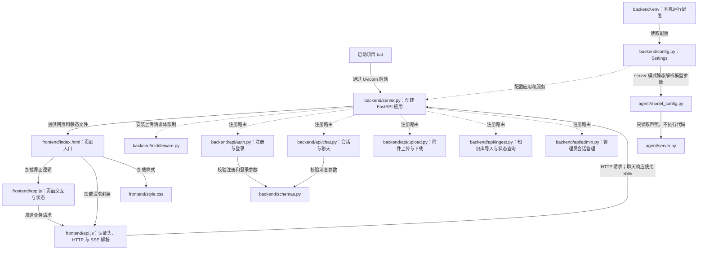
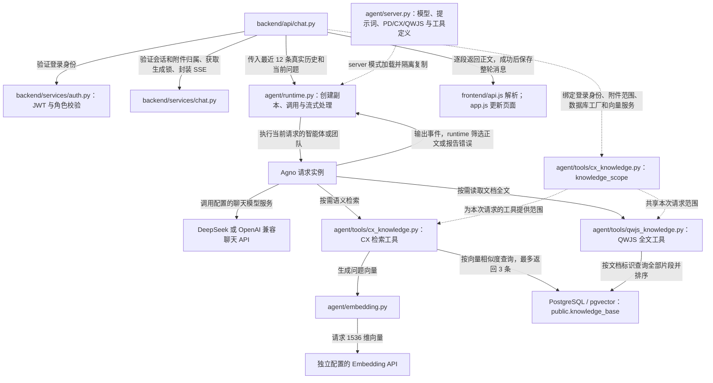
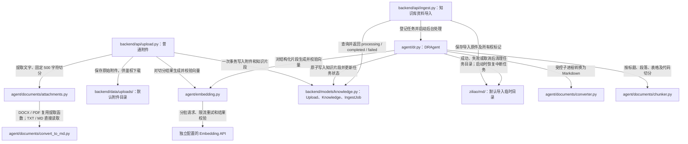
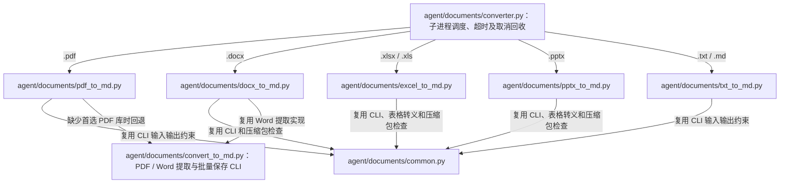
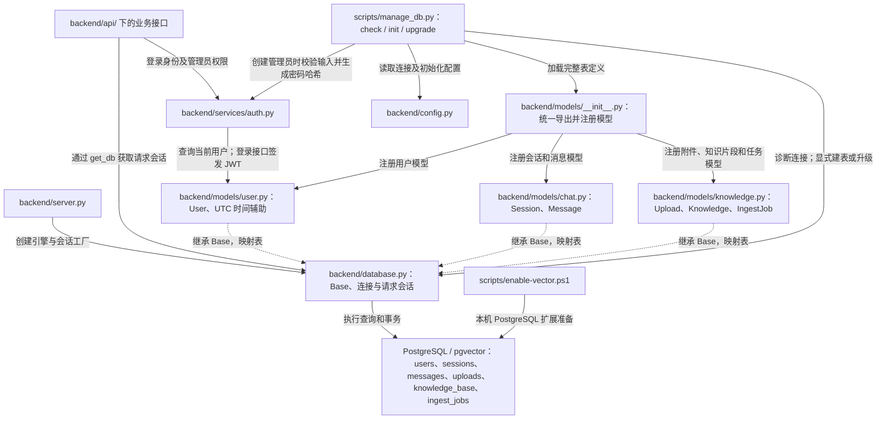

<!-- 文件作用：项目总说明，汇总文件关系图、环境配置、启动、数据库维护和验证方法。
关联关系：阅读入口；连接 docs/project-structure.md、后端及智能体各模块的使用说明。 -->
# 资料查询助手：后端与文档转换工具

后端位于 `backend/`，使用 FastAPI、SQLAlchemy 异步 PostgreSQL、pgvector、Agno。Vue 前端位于 `frontend/`（`index.html`、`api.js`、`app.js`、`style.css`），已接入真实 HTTP API，可注册、登录、上传资料、查询共享知识库、流式聊天及管理员管理会话。前端仍由后端通过根路径 `/` 提供，访问地址不变。

## 按功能分类的目录

```text
test7/
├─ frontend/             页面、样式、浏览器请求及交互
├─ backend/              HTTP 接口、认证、会话、数据库与数据模型
├─ agent/                智能体定义、执行、模型配置、向量服务与 DR 导入
│  ├─ tools/             CX 检索和 QWJS 全文查询
│  └─ documents/         附件提取、切分及各格式转换
├─ tests/                全项目回归测试
│  ├─ backend/           接口、权限、附件、导入与维护命令
│  ├─ agent/             智能体、模型协议、配置及检索工具
│  ├─ documents/         文档转换与结构化切分
│  ├─ frontend/          Node 前端交互与流式解析测试
│  ├─ integration/       可选真实数据库及 HTTP 服务验收
│  ├─ conftest.py        公共临时客户端 fixture
│  └─ helpers.py         测试账号辅助
├─ scripts/              数据库维护命令与本机扩展准备
├─ requirements/         runtime.txt / dev.txt / lock.txt 依赖清单
├─ docs/                 当前目录、需求、设计及实施记录
│  └─ verification/      功能验收记录
├─ ziliao/               原始资料及 Markdown，存储位置保留
├─ 启动项目.bat          根目录一键启动入口
└─ README.md             项目总说明与文件关系图
```

维护命令现在使用 `python -m scripts.manage_db`，运行依赖使用 `pip install -r requirements/runtime.txt`。原 `fronted/` 已更名为 `frontend/`，测试从 `backend/tests/` 移至根目录按功能分类；网站 URL、API、`.env` 配置及上传/资料存储路径不变。完整迁移说明见 [项目结构](docs/project-structure.md)。

## 文件连接与职责

以下按运行流程展示主要文件之间的调用、装配和读写关系。实线表示调用、加载或数据读写，虚线表示配置、注册或上下文绑定；每条线的文字说明具体作用。`backend/server.py` 是网站入口，`agent/server.py` 是智能体定义，两者承担不同职责。支持 Mermaid 的 Markdown 阅读器可直接显示这些图。

### 1. 网站启动、前端与后端接口



`backend/server.py` 还连接数据库，并把回答、向量化、转换和导入处理分别装配到 `app.state.answer`、`app.state.embed`、`app.state.convert`、`app.state.dr`。这些运行实例对应后续各图中的服务；接口通过应用状态调用它们。

### 2. 聊天、智能体与资料查询



`runtime.py` 负责网站如何执行 AI；`server.py` 负责 AI 的定义。上图中的 CX/QWJS 是 `server` 模式源团队提供的工具；`env` 模式由 `runtime.py` 按配置创建单智能体，默认不挂载这两个工具。聊天接口不自动预检索；QWJS 读取全文不调用 embedding。资料正文由已登录账号共享，显式附件范围仍会传给工具。

### 3. 普通附件与知识库导入



普通附件接口在提取和向量入库成功后返回；知识库导入先返回 `processing`，前端轮询任务状态。图中的 `models/knowledge.py` 定义数据表；实际数据库会话由 `backend/database.py` 提供。两条路径的切分算法和原件保留方式不同，不能直接互换。

### 4. 文档转换工具之间的关系



`converter.py` 返回 Markdown 文本给 DR 导入流程；`convert_to_md.py` 还可以独立执行批量转换并保存 `.md` 文件。`agent/documents/README.md` 说明独立转换用法。这些工具在本地提取文字，后续向量化才调用配置的外部向量服务。

### 5. 数据库、认证与维护命令



`check` 只读诊断；`init` 显式建表并可交互创建管理员；`upgrade` 为已有库补充导入相关结构。网站正常启动不会自动执行这些维护命令。用户、会话、原始附件下载和导入任务状态按账号权限校验；知识片段的查询共享规则见前文聊天关系图。

其余辅助文件与目录：

| 文件或目录 | 作用及连接关系 |
| --- | --- |
| `backend/.env.example` | 配置模板；首次配置时复制为 `.env`，由 `config.py` 读取 |
| `requirements/runtime.txt` | Python 运行依赖，供安装使用 |
| `requirements/dev.txt` | 引用运行依赖，补充 pytest 等测试工具 |
| `requirements/lock.txt` | 固定依赖版本清单，供环境复现使用 |
| `tests/backend/`、`tests/agent/`、`tests/documents/` | 按功能分类的 Python 回归测试，公共临时客户端由 `tests/conftest.py` 提供，账号辅助位于 `tests/helpers.py` |
| `tests/integration/` | 可选真实 PostgreSQL、向量索引、跨连接锁及 HTTP 服务验收；需显式启用 |
| `tests/frontend/` | 使用 Node 测试前端请求、SSE、聊天、导入轮询和 Markdown 渲染 |
| 各源码目录的 `__init__.py` | 声明 Python 包；`backend/models/__init__.py` 另负责集中注册和导出模型 |
| `docs/project-structure.md` | 当前目录及整理记录；其他 `docs/` 文件保留使用说明、验收和历史方案 |
| `ziliao/` | 原始资料及保留的 Markdown；其中导入临时任务子目录由 DR 单独管理 |

## 后端快速启动（PowerShell）

在项目根目录运行，建议 Python 3.12：

```powershell
python -m venv .venv
./.venv/Scripts/python.exe -m pip install -r requirements/runtime.txt
Copy-Item backend/.env.example backend/.env
./.venv/Scripts/python.exe -c "import secrets; print(secrets.token_urlsafe(48))"
```

将生成的随机值填入 `backend/.env` 的 `JWT_SECRET`。已生成的本机 `.env` 应保留，**不要重新复制覆盖**。该文件和上传目录已加入 `.gitignore`。

配置数据库及两个模型服务：

| 变量 | 用途 |
| --- | --- |
| `DATABASE_URL` | 默认本机 `wendang` 数据库，使用提示词指定的开发账号 |
| `JWT_SECRET` | 至少 32 字符，部署时独立随机生成 |
| `LLM_API_KEY` / `LLM_BASE_URL` / `LLM_MODEL` | OpenAI 兼容聊天接口，例如 DeepSeek 聊天服务；模型名称以实际服务支持为准 |
| `LLM_CONFIG_SOURCE` | `server` 调用 `agent/server.py` 中的 `deepseek_agent`；`env` 则使用 `.env` 中的聊天配置创建智能体 |
| `LLM_PROVIDER` | 使用 `env` 配置时为 `openai` 或 `deepseek` |
| `EMBEDDING_API_KEY` / `EMBEDDING_BASE_URL` / `EMBEDDING_MODEL` | 独立配置 embedding 服务，必须支持 1536 维向量及 `dimensions` 参数；默认 `text-embedding-3-small` |
| `CORS_ORIGINS` | JSON 数组，列出允许访问 API 的前端来源 |
| `MODEL_TIMEOUT_SECONDS` | 单轮检索和生成的总超时，默认 120 秒 |

本机使用 `LLM_CONFIG_SOURCE=server`：后端聊天调用 `D:\work\test7\agent\server.py` 的导出对象，优先 `pd_team`，其次 `deepseek_agent`、`cx_agent`。保留源定义的模型、指令和工具；团队及成员每次请求复制并关闭共享 SQLite 历史，网站历史由 PostgreSQL 管理。修改 `agent/server.py` 后需重启后端。

网站调用适配在 `agent/runtime.py`，Agent 定义在 `agent/server.py`，检索工具位于 `agent/tools/`，文档提取、切分和转换位于 `agent/documents/`。源 Agent 保留模型、团队和指令定义，检索工具从工具目录加载。

`agent/runtime.py` 同时负责历史消息整理和流式正文输出；向量服务统一位于 `agent/embedding.py`。知识库结构化切分、转换子进程调度分别位于 `agent/documents/chunker.py`、`agent/documents/converter.py`。`backend/services/` 保留网站认证和会话服务，详细目录见 [项目结构](docs/project-structure.md)。

资料导入处理模块为 `agent/dr.py`，类名 `DRAgent`、名称 `dr`，后端通过 `app.state.dr` 调用。它负责转换、切分、embedding、原子入库、任务恢复和临时文件清理，不额外调用聊天模型。导入 HTTP 路由、数据库模型与状态查询仍在 `backend/`，接口地址和启动方式不变。

CX 的 `search_cx_knowledge` 工具使用 `agent/tools/cx_knowledge.py` 的异步检索实现，明确查询 `public.knowledge_base` 的 `chunk_text`、`file_name`、`embedding`，最多返回 3 条。所有已登录账号共享全部入库资料，显式指定文件时只查询对应文件，复用网站 embedding 配置，不访问 Agno 默认的 `ai.knowledge_base`。团队与成员每次请求单独复制；未绑定登录身份时拒绝检索。请使用网站后端入口启动，以提供认证和数据库调用上下文。

聊天路径为“真实历史与当前问题 → PD → 按需调用 CX 或 QWJS”。后端不执行预检索，也不注入参考资料 JSON；只有实际工具检索时才生成查询 embedding，QWJS 按文件标识读取全文不需要 embedding。登录、会话归属及工具身份/附件范围继续校验。普通附件提取和 500 字切分独立位于 `agent/documents/attachments.py`，向量校验直接使用 `agent/embedding.py`。旧检索模块和回滚开关已移除。

启动配置校验会静态读取所选导出对象的 `DeepSeek(...)` 模型参数，支持字符串/布尔字面量及同文件顶层常量引用，允许团队和成员分别声明模型；实际运行则导入其中的团队或智能体。若改用环境配置独立创建智能体，可设置 `LLM_CONFIG_SOURCE=env` 并填写 `LLM_*`。

embedding 仍独立配置。只有聊天模型的服务不能自动承担 embedding。缺失密钥会返回明确配置错误，不会生成模拟回答。正式使用上传/RAG 会将资料文字发送给配置的 embedding 服务，命中片段发送给配置的聊天服务。

数据库需预先存在。用 PostgreSQL 超级用户连接 **wendang**，启用扩展一次：

```sql
CREATE EXTENSION IF NOT EXISTS vector;
```

本机 PostgreSQL 17 也可运行 `./scripts/enable-vector.ps1`，在弹出的本地提示中输入超级用户密码。应用账号需要在目标 schema 中建表的权限，无需日常使用超级用户。

数据库维护统一使用 `scripts.manage_db`，显式选择 `check`（只读诊断）、`init`（建表及可选管理员）或 `upgrade`（已有库升级）。原 `backend.check_db`、`backend.init_db`、`backend.migrate_ingest` 模块命令已合并移除；网站启动命令不变。

```powershell
# 建表；重复运行保留已有数据，不重置账号
./.venv/Scripts/python.exe -m scripts.manage_db init
# 已有数据库启用新导入模块前执行；可重复运行，保留已有资料
./.venv/Scripts/python.exe -m scripts.manage_db upgrade
# 可选：创建管理员，密码交互输入；已有同名账号不会被自动提权
./.venv/Scripts/python.exe -m scripts.manage_db init --admin admin
# 启动网站后端（智能体定义在 agent/server.py）
./.venv/Scripts/python.exe -m uvicorn backend.server:app --factory --host 127.0.0.1 --port 7777
```

访问 [资料查询助手](http://127.0.0.1:7777)、[接口文档](http://127.0.0.1:7777/docs)、[健康检查](http://127.0.0.1:7777/api/health)。使用 HTTP 访问前端；Vue CDN 首次加载需要联网。普通用户可直接注册，管理员使用上面的初始化命令创建。原 mock token 不再有效，请重新登录。

## 接口与数据规则

除注册、登录和健康检查外，API 请求需要 `Authorization: Bearer <token>`。管理员角色以数据库为准，不信任前端传入角色。

| 方法 | 路径 | 说明 |
| --- | --- | --- |
| POST | `/api/users` | 注册普通用户 `{username,password}` |
| POST | `/api/login` | 返回 `{token,role,username}` |
| GET / POST | `/api/sessions` | 当前用户会话列表 / 新建会话 |
| GET | `/api/sessions/{id}/messages` | 本人会话消息；管理员可以查看所有会话 |
| POST | `/api/sessions/{id}/messages` | `{content,fileIds}`，返回 SSE |
| POST | `/api/upload` | multipart `file`；文本解析、向量化完成后返回 `{fileId,fileName,size,url}` |
| GET | `/api/files/{fileId}` | 鉴权下载，前端通过 fetch 携带 token |
| GET | `/api/admin/sessions` | 管理员汇总列表 |
| DELETE | `/api/admin/sessions/{id}` | 管理员删除会话并级联删除消息 |

普通附件上传支持 PDF、DOCX、UTF-8 TXT/Markdown；单文件 20 MB、最多 2000 个 500 字片段。扫描 PDF 需先 OCR；空文件、损坏文件和无文字资料拒绝入库。默认资料问答由 PD 按需委派 CX 检索，不执行后端的前 5 块预检索。所有已登录账号均可查询其他账号上传的资料正文；指定 `fileIds` 时只检索这些文件。会话、原始附件下载、消息附件归属和导入任务状态仍按账号权限校验，匿名用户不能查询。资料独立于会话，删除会话不会删除知识库文件。

全文查看：例如输入 `09_外观检测相机与追溯接入.pdf中全部内容`。默认由 PD 委派 QWJS，通过全文工具按 `chunk_index` 顺序读取全部片段；文件名、标题和文档 ID 均可用于定位。工具返回正文或自然语言提示，不返回 JSON 外壳。同名多份需指定文档 ID，过长时明确提示。正文可能包含切分时的重叠文字，不代表恢复原文件版式；PD 的委派和最终表达遵循 `agent/server.py` 的现有指令。

根据原句查来源并查看全文：例如 `查询「空压站仅有总管指针表，支路异常时无法区分设备耗气变化和压力波动。」出自哪篇文档，并输出该文档全文`。流程需 PD 先委派 CX 定位来源，再用 QWJS 读取目标文件；多个候选需确认，不应把相似片段冒充原句出处。

密码 6–64 字符，bcrypt 另限制 UTF-8 长度不超过 72 字节。用户名 3–32 位字母、数字或下划线，统一小写。JWT 默认有效 8 小时。

SSE 使用 POST fetch，不使用只能 GET 的 EventSource：

```text
event: delta
data: {"content":"回答片段"}

event: done
data: {"msgId":"m_...","role":"ai","content":"完整回答","files":[],"time":"..."}

```

失败返回 `event: error`，数据含 `message` 和 `status`，不会发送 `done`。只有整轮成功才原子保存用户和 AI 消息；流中失败或检测到断开时不保存半轮消息。若提交成功后网络断开，前端会提示刷新确认，避免误以为未保存。并发生成使用 PostgreSQL advisory lock，保存时额外检查会话版本。

初始化使用 `create_all` 建立初始表及 HNSW 余弦索引，需要 pgvector >= 0.5。现有表后续结构变更需明确数据库迁移；重复初始化不是迁移工具。生产部署前更换文档中的开发数据库密码，配置 HTTPS，并按访问量配置反向代理限流；代理需关闭 SSE 缓冲。数据库应与 `backend/data/uploads` 一起备份。

## 导入资料

聊天页面“导入资料”使用独立知识库流程；“添加附件”维持原来 20 MB 的消息附件行为。导入支持 PDF、DOCX、XLSX、XLS、PPTX、UTF-8 TXT/MD，最大 50 MB。上传后立即返回任务 ID，页面每 2 秒查询状态；成功提示片段数，失败提示原因。切换页面停止轮询，服务器仍继续处理已接收任务。

```powershell
./.venv/Scripts/python.exe -m pip install -r requirements/runtime.txt
./.venv/Scripts/python.exe -m scripts.manage_db upgrade
```

在 `backend/.env` 配置 `EMBEDDING_API_KEY`（优先）或 `OPENAI_API_KEY`（兼容回退），模型默认 `text-embedding-3-small`，向量固定 1536 维。导入、附件入库和聊天检索共享 embedding 配置。每批 20 个片段；429 最多重试 3 次，间隔 1、2、4 秒，不叠加 SDK 自动重试。

若提示“向量服务密钥无效（401）”，需更换 `EMBEDDING_API_KEY`；使用 `OPENAI_API_KEY` 时必须将前者清空，避免仍优先使用无效值。修改 `.env` 后重启后端再导入。

转换器在受控子进程运行：PDF 优先 PyMuPDF4LLM，DOCX 保留段落/表格，Excel 每个工作表生成标题和表格，PPTX 按页提取文字/表格和图片占位。扫描 PDF 不自动 OCR；空文件、损坏格式和无法提取正文的文件会失败。单份转换文本最多 200 万字符、默认最多 2000 片段；Office 解压总量最多 100 MB，超过时请拆分。

切分按 Markdown 标题路径、段落和句子组织，目标 200–600 字，最多 800 字；章节末尾可较短。同节相邻片段重叠 1–2 个短句，不跨标题混入其他章节；超长无标点内容按上限拆分。metadata 含 source_file、chunk_index、heading_path、char_count。围栏代码不会误识别为标题，长表格/代码尽量按行拆分。

临时文件仅存于 `ziliao/md/<UUID>/`，转换完成或任务失败即清理；知识库保留文本、向量及来源元信息，不提供导入原件下载。启动时将上次中断的 processing 任务标记 failed；上传阶段崩溃遗留目录只有在 UUID 和本功能所有权标记均匹配时才会回收，不删除其他资料。

当前任务管理按单进程设计，启动时不要传 `--workers`。默认同时处理 2 份资料；配置 `INGEST_CONCURRENCY`、`CONVERTER_TIMEOUT_SECONDS`、`INGEST_TIMEOUT_SECONDS` 可调整。转换和 embedding 期间不占数据库事务；全部片段一次事务入库，失败不留下部分记录。

接口（均需 Bearer token，仅任务创建者可查询）：

| 方法 | 路径 | 返回 |
| --- | --- | --- |
| POST | `/api/ingest`，FormData 字段 `file` | 202 `{fileId,fileName,chunkCount:0,status:"processing"}` |
| GET | `/api/ingest/status/{fileId}` | `{fileId,status,chunkCount,error}`，状态 processing/completed/failed |

PowerShell 使用 `curl.exe`，避免 `curl` 别名差异：

```powershell
$env:INGEST_TOKEN='<登录接口返回的 token>'
curl.exe -X POST http://127.0.0.1:7777/api/ingest -H "Authorization: Bearer $env:INGEST_TOKEN" -F "file=@D:/资料/说明.pdf"
curl.exe http://127.0.0.1:7777/api/ingest/status/<fileId> -H "Authorization: Bearer $env:INGEST_TOKEN"
# 单独测试各转换器（stdout 为 Markdown）
./.venv/Scripts/python.exe -m agent.documents.pdf_to_md "D:/资料/说明.pdf"
./.venv/Scripts/python.exe -m agent.documents.docx_to_md "D:/资料/说明.docx"
./.venv/Scripts/python.exe -m agent.documents.excel_to_md "D:/资料/说明.xlsx"
./.venv/Scripts/python.exe -m agent.documents.pptx_to_md "D:/资料/说明.pptx"
./.venv/Scripts/python.exe -m agent.documents.txt_to_md "D:/资料/说明.md"
```

完整源代码已保存到项目。导入 API 与数据库模型位于 `backend/`，导入处理模块位于 `agent/dr.py`，转换工具位于 `agent/documents/`，测试位于 `tests/`。

## 后端验证

```powershell
./.venv/Scripts/python.exe -m pip install -r requirements/dev.txt
./.venv/Scripts/python.exe -m pytest -q
node --test tests/frontend/test_sse.cjs
node --test tests/frontend/test_chat_ui.cjs
node --test tests/frontend/test_ingest_ui.cjs
node --test tests/frontend/test_markdown_ui.cjs
# 对 .env 中的 PostgreSQL 运行集成测试（也可指定专用测试库 URL）
$env:TEST_DATABASE_URL='configured'
./.venv/Scripts/python.exe -m pytest tests/integration/test_postgres.py -q
./.venv/Scripts/python.exe -m pytest tests/integration/test_ingest_postgres.py -q
./.venv/Scripts/python.exe -m scripts.manage_db check
# 真实启动、HTTP 和重启持久化验收（仅创建并清理随机测试账号）
$env:RUN_LIVE_SMOKE='1'
./.venv/Scripts/python.exe -m pytest tests/integration/test_live_server.py -q
```

快速 API 测试使用临时 SQLite，仅验证业务路由及事务，不替代真实向量测试。PostgreSQL 测试在随机测试 schema 中验证共享向量排序、文件范围、级联删除、跨连接锁，并只清理自己创建的 schema。会话和原件权限通过 API 回归测试验证。需要测试账号有建 schema 权限；未设置 `TEST_DATABASE_URL` 时明确跳过。

Agno 流式测试使用真实框架和受控 HTTP 上游，不消耗模型额度。真实付费模型调用还需配置有效密钥后手动上传、提问验证。`requirements/lock.txt` 是本次 Python 3.12 环境的运行与测试依赖快照，可用于复现。

## 原有 PDF 和 Word 转 Markdown 工具

转换脚本位于 `agent/documents/`，依赖统一在 `requirements/runtime.txt`，转换测试位于 `tests/documents/`；示例转换结果保留于 `ziliao/md/`。详见 [转换工具说明](agent/documents/README.md)。

```powershell
python -m pip install -r requirements/runtime.txt
python agent/documents/convert_to_md.py ziliao -r
```
